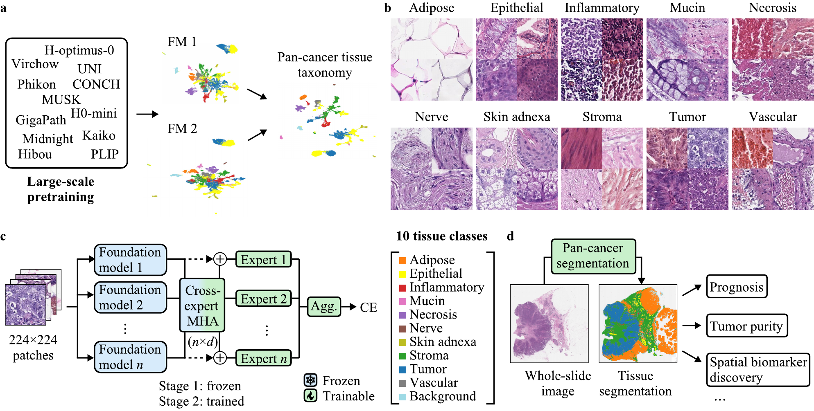
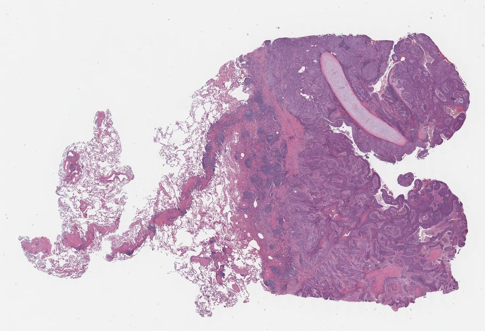
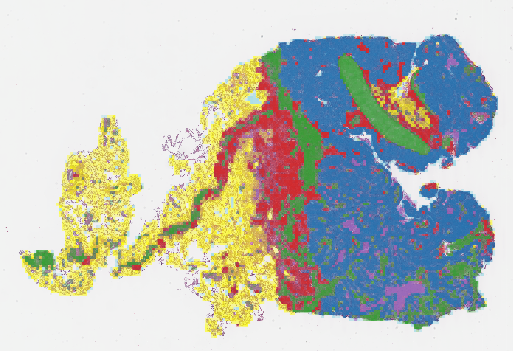
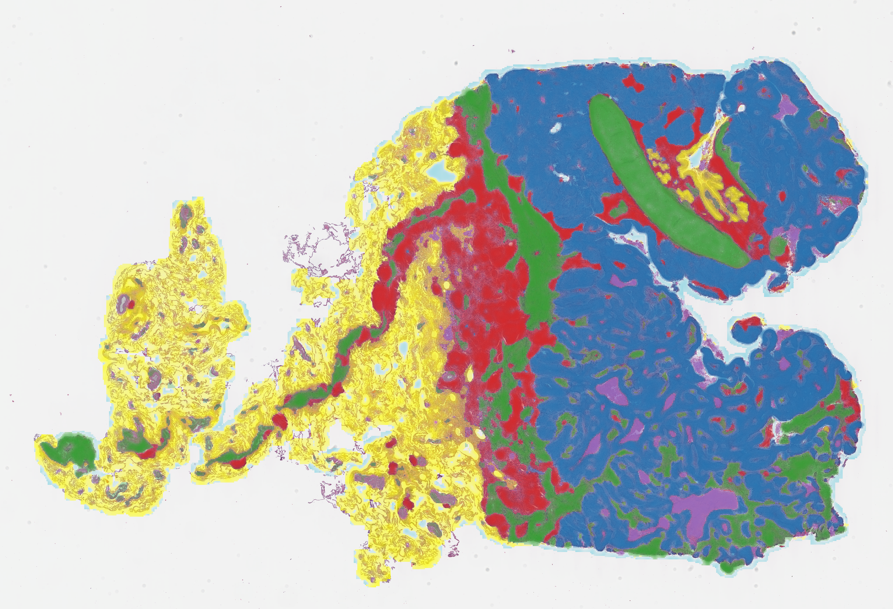

# Pan-Cancer Segmentation via Cross-Expert Ensembles of Pathology Foundation Models

**Abstract**: Tissue segmentation in computational pathology is essential for the systematic characterization of the tumor architecture and microenvironment, enabling downstream analyses such as the quantification of clinically relevant tissue proportions and survival prediction. However, current segmentation datasets are limited in both scale and organ coverage, with large-scale tissue type annotations available only for common organs. We present a pan-cancer segmentation framework trained on 598,577 image patches from six organs (breast, colorectal, lung, skin, thorax, and prostate) across eight data sources, encompassing the most common cancer types. To achieve segmentations that generalize across different organs, we curate a unified taxonomy of 10 tissue types (epithelial, adipose, inflammatory, mucin, necrosis, nerve, skin adnexa, stroma, tumor, and vascular) and one background artifact class. Our approach aggregates complementary features from pretrained pathology foundation models across expert heads. We demonstrate that pan-cancer training yields performance on par with organ-specific models, achieving 96.1% F1 on a combined pan-cancer test set, while generalizing to unseen organs: our model reaches 78.3% F1 on held-out lung tissue, substantially outperforming organ-specific SPIDER models (12-54% F1) and single-backbone baselines (62-65% F1) on the same test set.



## Visualization

### 1. Setup
To run the segmentation model on a set of slides, you first need to have a folder containing all the slides you want to segment.

You can for example test the code on slides from TCGA. For this just download the slides you want as such:

```bash
wget --content-disposition https://api.gdc.cancer.gov/data/9102b9c1-77ae-4fa0-9683-53be8a998ceb
mkdir data
mv TCGA-22-5479-01Z-00-DX1.3DCD4654-459D-4046-87C3-E59C61A1E7FA.svs data/
```




### 2. Feature Extraction
We use the TRIDENT pipeline to extract the features from each WSI. 
Clone the [repository](https://github.com/mahmoodlab/TRIDENT) locally, and follow the instructions from the repository to create a new virtual environment with the required dependencies.

```
conda create -n "trident" python=3.10
conda activate trident
git clone https://github.com/mahmoodlab/TRIDENT.git && cd TRIDENT
pip install -e .
```

After that run Trident on the WSIs. Our best model is trained on features extracted with two encoders, H-optimus-0 and Virchow2. So you need to run the following command two times, once for each encoder:

```bash
cd ..
python ./TRIDENT/run_batch_of_slides.py \
    --task all \
    --wsi_dir data \
    --job_dir trident \
    --patch_encoder hoptimus0 \
    --mag 20 \
    --patch_size 224 \
    --overlap 0  # choose a higher overlap for smoother segmentation maps, eg. 168 for 75% overlap

python ./TRIDENT/run_batch_of_slides.py \
    --task all \
    --wsi_dir data \
    --job_dir trident \
    --patch_encoder virchow2 \
    --mag 20 \
    --patch_size 224 \
    --overlap 0
```

where the ```wsi_dir``` is the directory where you store your original WSIs and ```overlap``` specifies the overlap between adjacent patches (More overlap usually means a smoother segmentation map requiring more compute).
The ```output_dir``` is where trident stores the computed features.

### 3. Segmentation

Create a new virtual environment and install the dependencies required for segmentation:

```bash
conda create -n "segmentation" python=3.10
conda activate segmentation
pip install -r requirements/visualization_requirements.txt
```

We provide trained **H-optimus-0 + Virchow2 ensemble weights** in the checkpoint dictionary format saved by `training.py`:

| Model | Checkpoint |
| --- | --- |
| Pan-cancer ensemble | [`outputs/H-optimus-0,Virchow2/best_linear_probe.pt`](outputs/H-optimus-0,Virchow2/best_linear_probe.pt) |
| Ensemble trained with lung excluded | [`outputs_lung_excluded/H-optimus-0,Virchow2/best_linear_probe.pt`](outputs_lung_excluded/H-optimus-0,Virchow2/best_linear_probe.pt) |

Each checkpoint contains the trained segmentation heads and cross-attention parameters. Only `best_linear_probe.pt` is needed from the training outputs for inference. In addition both encoders' extracted features are required as described above.

After that you can run the segmentation using our pretrained model weights with the following command:
```bash
python testing/visualization.py \
    --features_dir trident/20x_224px_0px_overlap \
    --wsi_dir data \
    --out_dir trident/20x_224px_0px_overlap/segmentations \
    --model_dir outputs/H-optimus-0,Virchow2
```

- ```features_dir```: specify the folder where extracted features from TRIDENT are stored. Note: Inside this folder you'll find subfolders like ```features_virchow2```. This is usually a subfolder of the ```out_dir``` you specified in Step 2. For example, if you used ```overlap = 0``` then the folder should be called ```20x_224px_0px_overlap```.
- ```model_dir```: specify the folder containing `best_linear_probe.pt`. Use `outputs/H-optimus-0,Virchow2` for the pan-cancer ensemble or `outputs_lung_excluded/H-optimus-0,Virchow2` for the ensemble trained with lung excluded.
- ```wsi_dir```: specify the directory containing the original WSIs.
- ```out_dir```: specify the output directory.

Optional arguments are:
- ```--no_legend```: render without a legend.
- ```--predictions_only```: generate only the CSVs with the predictions.

You can specify the confidence threshold in the code by changing the value of the variable ```CONFIDENCE_THRESHOLD``` in ```testing/visualization.py```. By default, it is set to 0.25, meaning that predictions with confidence below 0.25 will be marked as uncertain and will be left blank in the segmentation map.

You will find the segmented slides in the output directory you specified (`trident/20x_224px_0px_overlap/segmentations`). Here is are example segmentations of the given slide with 0 px (first) and 168 px (second) overlaps:





## Training

Run the commands below from the repository root (the directory containing `training.py`).
### 1. Environment

Create a Python 3.10 environment and install the dependencies:

```bash
conda create -n pancancer-training python=3.10
conda activate pancancer-training
python -m pip install -r requirements/training_requirements.txt
```

Make sure you have access to the selected backbone weights on Hugging Face and authenticate before training.

### 2. Training data

Create a `Data/` directory inside the repository root. Its expected layout for building training tiles from source datasets is:

```text
Data/
├── BCSS/
│   ├── images/                     # Histology images
│   ├── masks/                      # Same filenames and dimensions as images
│   └── meta/gtruth_codes.tsv        # Header, then label name + integer code (tab-separated)
├── SPIDER-skin/SPIDER-skin/
│   ├── images/
│   └── metadata.json
├── SPIDER-thorax/SPIDER-thorax/
│   ├── images/
│   └── metadata.json
├── SPIDER-breast/SPIDER-breast/
│   ├── images/
│   └── metadata.json
├── SPIDER-colorectal/SPIDER-colorectal/
│   ├── images/
│   └── metadata.json
├── LubLung/LubLung/<original-class-name>/   # PNG/JPG/JPEG patches
├── Kather/NCT-CRC-HE-100K-NONORM/<class>/    # TIF patches
└── Kather-5000/<class>/                    # TIF patches
```

Acquire and extract these datasets separately. Keep the original class directory names expected by `dataset_mappings.py`. Each SPIDER `metadata.json` is a list of records containing `image_name`, `class`, and `split` (the training loader selects `train`); the image filenames refer to files under `images/`. See `spider/spider_dataset.py` for the full format. 

On the first run, the script generates:

```text
Data/Unified Dataset/
├── tiles224/
│   ├── index.csv
│   └── <unified-class-name>/*.png
└── embeddings/
    ├── H-optimus-0/all.pt
    └── Virchow2/all.pt
```

If you already have prepared data, supply `tiles224/index.csv` and the tiles it references to skip source dataset preparation. The CSV columns are `path,unified_label_id,unified_label_name,source,original_label,organ`; paths must resolve from the repository root. Labels follow `UNIFIED_LABELS` in `data_utils.py`. Embeddings are optional caches, created automatically when missing. Existing `all.pt` caches must correspond to the same index rows in the same order and contain `X`, `y`, and `paths`.

### 3. Run training

```bash
python training.py --output_dir outputs
```

By default, training uses **H-optimus-0 and Virchow2**, trains the expert heads for 10 epochs, then fine-tunes the ensemble with embedding cross-attention for 5 epochs. 

We provide two ensemble checkpoints in this repository: one trained on the full pan-cancer training set (`outputs/H-optimus-0,Virchow2/best_linear_probe.pt`) and one trained with LubLung excluded (`outputs_lung_excluded/H-optimus-0,Virchow2/best_linear_probe.pt`).

Use `--test_organs` to select organs excluded from both training and validation. Use `--test_organ` to select which of those held-out organs is evaluated after training.

In this example, lung and thorax are both held out, but the final evaluation uses only lung samples:

```bash
python training.py \
    --output_dir outputs \
    --test_organs lung thorax \
    --test_organ lung
```

Set `--test_organ ""` to evaluate the entire test set together. A named evaluation target must have samples in the test set. Pass `--test_organs` with no values to disable organ holdout.

You can combine organ holdout with `--test_fraction`. The script first puts all samples from `--test_organs` into the test set, then adds a class-stratified fraction of the remaining patches to that same test set. For example:

```bash
python training.py \
    --output_dir outputs \
    --test_organs lung thorax \
    --test_fraction 0.2 \
    --test_organ ""
```

This reserves all lung and thorax patches plus 20% of patches from the remaining organs for testing, and evaluates the combined test set. Using `--test_organ lung` instead evaluates only its lung samples; the other test samples remain excluded from training and validation.

`--test_fraction` does not control validation. After both test selections, `VAL_FRACTION` in `training.py` determines the validation fraction of the remaining patches; the rest are used for training. Set `VAL_FRACTION = 0.0` to disable validation.

Use `--exclude_sources BCSS` to exclude a data source from training/validation/test splitting. Model selection (`MODEL_NAMES`), epochs, learning rates, batch size, and validation fraction are configured near the top of `training.py`. Run `python training.py --help` for all CLI options.

With the default model configuration and `--output_dir outputs`, the final checkpoint is saved to `outputs/H-optimus-0,Virchow2/best_linear_probe.pt`. Pass `outputs/H-optimus-0,Virchow2` to the visualization script using `--model_dir`.
